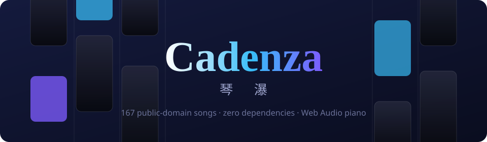
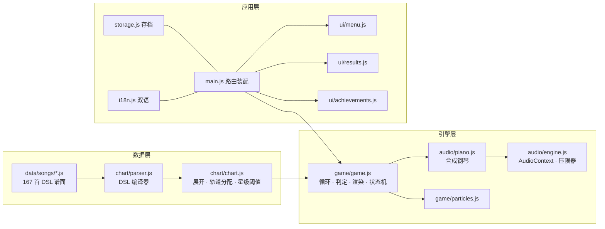

<div align="center">



# Cadenza · 琴瀑

**一款《钢琴块2》风格的开源网页节奏音游 · A Piano-Tiles-style open-source web rhythm game**

[](LICENSE)
[](#技术架构)
[](#曲库)
[](https://github.com/appleweiping/cadenza/actions/workflows/ci.yml)

**[▶ 在线试玩 / Play Online](https://appleweiping.github.io/cadenza/)**

[中文](#中文) · [English](#english)

</div>

---

> **免责声明 / Disclaimer**
> 本项目是受《钢琴块2》(Piano Tiles 2)启发的**非官方**开源致敬之作,与猎豹移动(Cheetah Mobile)无任何关联。
> 所有代码为原创(MIT 协议);所有曲目均为**公有领域**作品(作曲家逝世均超过 70 年,或为传统民谣),由作者逐音符自制转谱;不包含任何原版游戏的音频、美术或其他素材。
> This is an **unofficial** open-source homage inspired by Piano Tiles 2, not affiliated with Cheetah Mobile. All code is original (MIT). All music consists of **public-domain** compositions transcribed note-by-note by the author. No assets from the original game are included.

---

# 中文

## 简介

**Cadenza(琴瀑)** 是一款零依赖、纯原生 JavaScript 实现的网页节奏音游:黑色方块沿四条轨道倾泻而下,点中它们,旋律便从你的指尖流出。完整还原了《钢琴块2》的核心手感——**音乐由点击驱动**:每个方块携带真实的乐谱音符,点得越快,曲子就弹得越快。

- **167 首曲目**,横跨 14 张专辑:从《小星星》到《野蜂飞舞》,从《茉莉花》到《哈利路亚》
- **9,200+ 个方块**全部由紧凑谱面 DSL 逐音符手工转谱,配校验工具与 CI 把关
- **零依赖、零构建**:克隆即玩,GitHub Pages 直接部署
- **合成钢琴音色**:Web Audio 实时合成,仓库里没有一个音频文件

## 特性

| | |
|---|---|
| 🎹 **点击驱动音乐** | 方块即音符,旋律随你的手速流动,还原《钢琴块2》的灵魂手感 |
| 🧱 **四种方块** | 单击 · 长按(按住蓄分)· 双押(双指齐按)· 高速连击串 |
| 👑 **三圈皇冠制** | 每跑完一圈提速 ×1.16 并获得皇冠(最多 3 枚),之后无限加速刷分 |
| ⭐ **三级星评** | 星级阈值由谱面满分自动推导,存档永久保留最佳纪录 |
| 🎯 **三档判定** | PERFECT ×3 / GREAT ×2 / GOOD ×1,连续 PERFECT 累积连击 |
| 💜 **一次复活** | 失败后可免费复活一次(回退一屏 + 倒计时),可在设置关闭 |
| 🗺 **进度解锁** | 14 张专辑按累计星数渐进解锁,也可在设置一键全开 |
| 🏆 **24 个成就** | 从「初试琴声」到「人琴合一」,含 Toast 弹出提示 |
| 📊 **玩家等级与统计** | 得分转经验升级;总点击 / PERFECT 数 / 最高圈数等全量统计 |
| 🌐 **中英双语** | 跟随系统语言,可随时切换 |
| 📱 **全端操作** | 多点触控 + 键盘 D/F/J/K,窗口失焦自动暂停 |
| 🎨 **每专辑主题配色** | 14 套渐变主题、命中粒子、判定浮字、连击特效 |

## 玩法说明

### 基本规则

1. 点击第一块「开始」方块后,方块开始下落;
2. **只点黑块**:点到空白轨道立即失败;方块滑出屏幕底部(超过 0.25 拍宽限)也会失败;
3. 方块必须按顺序命中——面板会强制你追上乐曲的脚步;
4. 跑完一整圈获得一枚皇冠并提速 ×1.16,三圈集满后进入无限加速模式,直到失误或退出结算。

### 方块类型

| 方块 | 写法(DSL) | 操作 | 得分 |
|---|---|---|---|
| 单击块 | `E5/8` | 点一下 | 判定分 × 圈数 |
| 和弦块 | `(C4,E4)/4` | 点一下,奏出和弦 | 判定分 × 圈数 |
| 长按块 | `A4/2~` | 按住直到尾端 | 判定分 + 2 分/拍 × 圈数 |
| 双押块 | `[C4+E4]/4` | 两轨同时按下 | 两块各自判定计分 |

### 判定与计分

判定按**点击瞬间方块底边的位置**分档(越贴近屏幕底部越准):

| 判定 | 触发区域(底边位置) | 得分 |
|---|---|---|
| **PERFECT** | 屏幕下方 30% 区域内(或恰好越过底边) | 3 × 当前圈数 |
| **GREAT** | 42% ~ 70% 区域 | 2 × 当前圈数 |
| **GOOD** | 其余可点击区域 | 1 × 当前圈数 |

- 长按块在按住期间以 **2 分/拍 × 圈数** 持续积分,提前松手保留已得部分;
- 连续 PERFECT 形成连击(结算显示最大连击);
- 星级阈值:1★ = 单圈满分 × 1.0,2★ = × 3.0,3★ = × 5.0(要拿 3★ 必须撑进第三圈以后)。

### 操作

| 平台 | 操作 |
|---|---|
| 触屏 | 四条轨道分区多点触控;长按块按住不放 |
| 键盘 | `D` `F` `J` `K` 对应四条轨道;`Esc` 暂停 |

## 曲库

167 首曲目 / 9,222 个方块,全部为公有领域作品的自制转谱。难度分布:★×25 · ★★×65 · ★★★×50 · ★★★★×20 · ★★★★★×7。

| 专辑 | 曲目数 | 解锁需求 | 代表曲目 |
|---|---|---|---|
| 🌱 启程 | 14 | — | 小星星 · 两只老虎 · 筷子圆舞曲 |
| 🏮 中国旋律 | 10 | — | 茉莉花 · 送别 · 彩云追月 · 二泉映月 |
| 🎻 维也纳古典 | 14 | 2★ | 致爱丽丝 · 土耳其进行曲 · 月光奏鸣曲 |
| ⛪ 巴洛克 | 12 | 6★ | 卡农 · C大调前奏曲 · D小调托卡塔 |
| 🌹 浪漫主义 | 15 | 10★ | 夜曲 Op.9-2 · 梦幻曲 · 演艺人 |
| 🩰 芭蕾与歌剧 | 14 | 15★ | 天鹅湖 · 哈巴涅拉 · 女武神的骑行 |
| 💫 圆舞曲之夜 | 6 | 20★ | 蓝色多瑙河 · 溜冰圆舞曲 |
| 🥁 进行曲 | 8 | 26★ | 拉德茨基 · 威风凛凛 · 角斗士 |
| 🌸 东方之韵 | 6 | 32★ | 樱花 · 荒城之月 · 阿里郎 |
| 🍀 凯尔特与不列颠 | 13 | 38★ | 绿袖子 · 丹尼少年 · 斯卡布罗集市 |
| 🤠 美洲民谣 | 14 | 45★ | 奇异恩典 · 圣者的行进 · 星条旗 |
| 🌍 世界之声 | 14 | 52★ | 我的太阳 · 货郎(俄罗斯方块主题曲)· 卡林卡 |
| 🎄 圣诞颂歌 | 15 | 60★ | 铃儿响叮当 · 平安夜 · 钟声颂歌 |
| 🔥 炫技巅峰 | 12 | 70★ | 野蜂飞舞 · 邮递马车 · 威廉·退尔 + 5 张 Pro 谱面 |

> **Pro 谱面**:同一乐曲的加强版谱面(更快、更密、更长选段),与《钢琴块2》的做法一致,在曲卡上以 `PRO` 徽章标注。

## 快速开始

```bash
git clone https://github.com/appleweiping/cadenza.git
cd cadenza

# 任选一种静态服务器(ES Modules 不能用 file:// 直接打开)
python -m http.server 8144
# 或
npx http-server -p 8144

# 浏览器打开 http://localhost:8144
```

校验曲库(需 Node ≥ 18):

```bash
node tools/validate-charts.mjs
```

## 技术架构

**零依赖原生 JS + Canvas 渲染 + Web Audio 合成**,无构建步骤,总计约 4,000 行(不含谱面数据)。



```
cadenza/
├── index.html              # 单页外壳:菜单/结算/设置用 DOM,玩法用 Canvas
├── css/style.css           # 全部样式(深色玻璃拟态主题)
├── js/
│   ├── main.js             # 入口:屏幕路由、弹窗、模块装配
│   ├── config.js           # 所有可调参数(判定区、倍率、速度步进…)
│   ├── i18n.js             # 中英双语词典
│   ├── storage.js          # localStorage 存档(带版本号)
│   ├── rng.js              # cyrb53 + mulberry32 确定性随机
│   ├── audio/
│   │   ├── engine.js       # AudioContext 生命周期、主增益、压限器
│   │   ├── piano.js        # 合成钢琴:多分音 + 包络 + 低通滤波
│   │   └── notes.js        # 音名 ↔ 频率
│   ├── chart/
│   │   ├── parser.js       # 谱面 DSL → tick 序列
│   │   └── chart.js        # 起拍计算、满分推导、种子化轨道分配
│   ├── game/
│   │   ├── game.js         # 核心:游戏循环、输入、判定、渲染、圈数状态机
│   │   └── particles.js    # 命中粒子
│   ├── ui/                 # menu / results / settings / achievements / stats
│   └── data/
│       ├── collections.js  # 14 张专辑(主题色、解锁条件)
│       └── songs/          # 每专辑一个文件,共 167 首
├── tools/validate-charts.mjs  # 谱面校验(CI 同款)
└── .github/workflows/      # CI 校验 + Pages 部署
```

### 三个关键设计

1. **点击驱动音频,天然零延迟校准。** 传统音游要对齐"预录音轨 vs 谱面滚动",延迟校准是永恒难题。Cadenza 反过来:滚动只是视觉节拍器,声音在你点击的瞬间由 Web Audio 合成——不存在音画不同步,也就不需要延迟设置。
2. **谱面即乐谱,单一真相源。** DSL 里写的是真实音符与时值:方块高度 = 时值 × 每拍像素,点击音 = 谱面音。写对谱面,视觉与听觉自动正确。
3. **确定性轨道分配。** 轨道由 `(歌曲id, 圈数)` 播种的 mulberry32 生成:同一圈永远同一图案(可复现),不同圈图案不同(有新鲜感),且保证相邻方块不同轨、双押两轨互异(可玩性)。

## 谱面 DSL 规范

每首歌是一个 JS 对象,旋律写在一个字符串里,空白分隔,`|` 小节线仅供阅读:

```js
export default [{
  id: 'my-song',                      // 小写连字符,全局唯一
  collection: 'baroque',              // 所属专辑 id
  difficulty: 3,                      // 1~5
  bpm: 96,                            // 基础速度(四分音符/分钟)
  vb: 3.5,                            // 可选:一屏可见拍数(方块尺寸),缺省按难度取
  pro: true,                          // 可选:Pro 谱面徽章
  title: { zh: '我的歌', en: 'My Song' },
  composer: 'J. S. Bach',
  score: `
    E5/8 D#5/16 E5/16 | A4/2~ | (C4,E4)/4 [C4+E4]/4 r/8 G4/8t
  `,
}];
```

| 记号 | 含义 |
|---|---|
| `E5/8` | 单击块:E5,八分音符 |
| `/1` `/2` `/4` `/8` `/16` `/32` | 全音符(4拍)~ 三十二分音符 |
| `/4.` | 附点(时值 ×1.5) |
| `/8t` | 三连音(时值 ×⅔) |
| `A4/2~` | 长按块(按住 2 拍蓄分) |
| `(C4,E4)/4` | 和弦块:一块奏多音,第一个音是主旋律 |
| `[C4+E4]/4` | 双押块:同排两块,各奏一音(每侧也可写和弦,逗号分隔) |
| `r/8` | 休止:时值并入前一块(方块间留白) |
| `\|` | 小节线,解析时忽略 |

音名规则:`C0`~`B8`,支持 `#` 与 `b`(如 `F#4`、`Bb3`)。

### 添加一首新歌(约 10 分钟)

1. 在 `js/data/songs/<专辑>.js` 的数组里加一个对象(参考上方模板);
2. 跑 `node tools/validate-charts.mjs`——它会检查音名、时值、tick 下限、双押结构、id 唯一性,并输出全库统计;
3. 刷新浏览器即可游玩。新专辑则在 `data/collections.js` 注册 + `data/songs/index.js` 引入。

**曲目准入红线**:只收录公有领域作品(作曲家逝世超 70 年或传统民谣),存疑一律不收。

## 持续集成与部署

- **CI**(`.github/workflows/ci.yml`):每次 push / PR 自动运行谱面校验,谱面写错直接红灯;
- **Pages**(`.github/workflows/pages.yml`):push 到 `main` 自动校验并部署到 GitHub Pages。

## 存档说明

进度保存在浏览器 `localStorage`(键 `cadenza.save.v1`),包含每曲最佳成绩/星/皇冠、经验等级、成就与统计。设置中提供「清空所有进度」(需二次确认)。存档带版本号,未来格式升级可平滑迁移。

## Roadmap

- [ ] 曲库继续扩充(DSL + 校验器已让加歌成本降到 10 分钟/首)
- [ ] 每周挑战曲目(种子化随机)
- [ ] 触屏延迟微调选项 · 演奏回放
- [ ] PWA 离线支持
- [ ] 更多合成音色(八音盒 / 电钢)

## 贡献

欢迎 PR!加歌是最简单的贡献方式——写谱面 → 过校验 → 提 PR。请确保曲目为公有领域,并在 PR 里注明作曲家与逝世年份(或注明传统民谣)。

## 许可

代码与谱面数据以 [MIT](LICENSE) 协议开源。

---

# English

## Overview

**Cadenza** is a zero-dependency, vanilla-JavaScript web rhythm game in the style of Piano Tiles 2: black tiles cascade down four lanes, and tapping them plays the melody. It faithfully recreates the core feel of the genre — **the music is driven by your taps**: every tile carries real notes from the score, so the faster you tap, the faster the piece plays.

- **167 songs** across 14 albums — from *Twinkle Twinkle* to *Flight of the Bumblebee*
- **9,200+ tiles**, every one hand-transcribed via a compact chart DSL, guarded by a validator and CI
- **Zero dependencies, zero build step** — clone and play; deploys straight to GitHub Pages
- **Synthesized piano** via Web Audio — not a single audio file in the repo

## Features

- 🎹 **Tap-driven music** — tiles are notes; the melody flows at your pace
- 🧱 **Four tile types** — tap, hold (accrues bonus), double (two lanes at once), and rapid 16th-note runs
- 👑 **Three-lap crown system** — each completed lap speeds the song up ×1.16 and awards a crown (max 3), then endless acceleration for score
- ⭐ **Three-star ratings** with thresholds derived automatically from each chart's max score
- 🎯 **Three-tier judgment** — PERFECT ×3 / GREAT ×2 / GOOD ×1, with PERFECT combo streaks
- 💜 **One free revive** per run (rewinds one screen with a countdown); can be disabled
- 🗺 **Progressive unlocks** — albums unlock by total stars; an "unlock all" toggle exists for those who just want to play
- 🏆 **24 achievements**, player level/EXP, and a full statistics page
- 🌐 **Full bilingual UI** (English / Chinese), following system language
- 📱 **Multi-touch + keyboard** (`D` `F` `J` `K`), auto-pause on tab blur
- 🎨 **14 album color themes**, hit particles, judgment floaters, combo effects

## How to Play

1. Tap the **START** tile to begin the scroll.
2. **Only tap black tiles.** Tapping an empty lane fails instantly; letting a tile slip past the bottom edge (beyond a 0.25-beat grace) also fails.
3. Tiles must be hit in order — the chart forces you to keep up with the music.
4. Finish a lap to earn a crown and speed up ×1.16. After three crowns the game keeps accelerating endlessly until you miss or cash out.

**Judgment** is positional — graded by where the tile's bottom edge sits when you tap: bottom 30% of the screen → PERFECT (×3), 42–70% → GREAT (×2), otherwise GOOD (×1). Holds accrue 2 pts/beat while held. Stars: 1★ = 1.0× one-lap max score, 2★ = 3.0×, 3★ = 5.0×.

## Quick Start

```bash
git clone https://github.com/appleweiping/cadenza.git
cd cadenza
python -m http.server 8144   # or: npx http-server -p 8144
# open http://localhost:8144  (ES modules can't run from file://)
```

Validate the song library (Node ≥ 18):

```bash
node tools/validate-charts.mjs
```

## Architecture

Zero-dependency vanilla JS + Canvas rendering + Web Audio synthesis. Three key design decisions:

1. **Tap-driven audio ⇒ no latency calibration.** Traditional rhythm games must sync a pre-recorded track against scrolling notes. Cadenza inverts this: scrolling is just a visual metronome, and sound is synthesized the instant you tap — audio/visual desync is structurally impossible.
2. **The chart is the score — single source of truth.** The DSL encodes real pitches and durations: tile height = duration × pixels-per-beat, and the tap sound = the chart's notes. Get the chart right and both visuals and audio are automatically right.
3. **Deterministic lane assignment.** Lanes are generated by a mulberry32 PRNG seeded with `(songId, lap)` — reproducible within a lap, fresh across laps, with playability constraints (no consecutive same-lane tiles; double tiles use two distinct lanes).

See the directory tree and mermaid diagram in the Chinese section above — the code layout is identical.

## Chart DSL

Each song is a JS object whose melody lives in one whitespace-separated string (`|` barlines are ignored):

| Token | Meaning |
|---|---|
| `E5/8` | Tap tile: E5, eighth note |
| `/1 /2 /4 /8 /16 /32` | Whole (4 beats) … thirty-second note |
| `/4.` | Dotted (×1.5) |
| `/8t` | Triplet (×⅔) |
| `A4/2~` | Hold tile (hold for 2 beats of bonus) |
| `(C4,E4)/4` | Chord tile — one tile, several notes; first note is the melody |
| `[C4+E4]/4` | Double tile — two tiles in one row, one note each (each side may be a comma chord) |
| `r/8` | Rest — merged into the previous tile's duration |

Note names span `C0`–`B8` with `#`/`b`. To add a song: append an object to a collection file in `js/data/songs/`, run `node tools/validate-charts.mjs`, refresh. **Only public-domain works are accepted** (composer dead 70+ years, or traditional).

## CI & Deployment

Every push runs the chart validator in GitHub Actions; pushes to `main` also validate and deploy to GitHub Pages automatically.

## License

Code and chart data are released under the [MIT License](LICENSE).
All music consists of public-domain compositions transcribed by the author. This project is an unofficial homage inspired by Piano Tiles 2 and is not affiliated with Cheetah Mobile.
