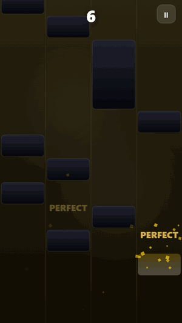
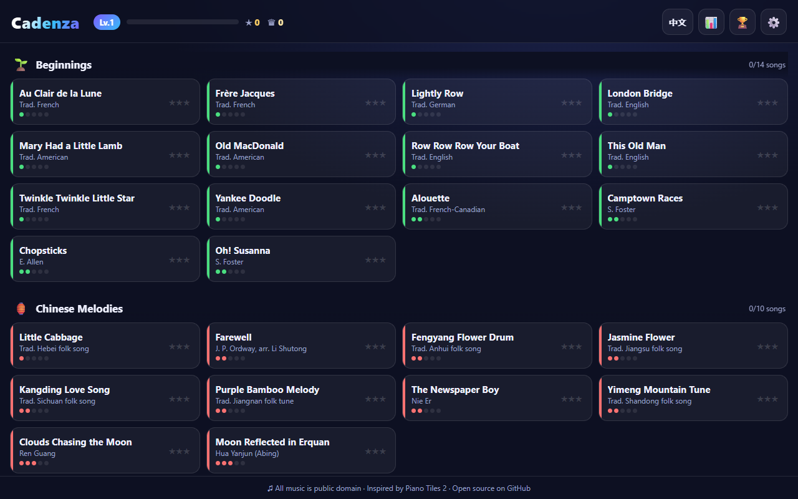

# Cadenza

A Piano Tiles-style rhythm game for the browser: tap the black tiles as they fall, and each tap plays the next note of a public-domain piece on a synthesized piano.

**Play it here: https://appleweiping.github.io/cadenza/** (works on phones too)



[中文说明](README.zh-CN.md)

## Controls

| Action | Touch / mouse | Keyboard |
|---|---|---|
| Hit a tile | Tap or click it | `D` `F` `J` `K` for the four lanes |
| Hold tile (a long tile) | Keep your finger down until it ends | Keep the key down |
| Double tile (two tiles in one row) | Tap both lanes | Press both keys |
| Pause | Pause button, top right | `Esc` |
| Switch language | `EN` / `中文` button in the menu header | |

Tapping an empty lane or letting a tile fall off the bottom ends the run (you get one free revive). Hits are graded by how low the tile is when you tap: PERFECT, GREAT or GOOD. Finishing the piece once earns a crown and the next lap is 16% faster; after three crowns it keeps speeding up until you miss.

The language follows your browser on first visit (Chinese if it is set to Chinese, English otherwise) and the header button remembers your choice.



## How charts work

The music is driven by your taps: there is no backing track. Each tile carries the notes it plays, and the scroll speed comes from the piece's tempo. So a chart is just a melody written in a small text notation:

```js
{
  id: 'my-song', collection: 'baroque', difficulty: 3, bpm: 96,
  title: { zh: '我的歌', en: 'My Song' },
  composer: 'J. S. Bach',
  score: `
    E5/8 D#5/16 E5/16 | A4/2~ | (C4,E4)/4 [C4+E4]/4 r/8 G4/8t
  `,
}
```

| Token | Meaning |
|---|---|
| `E5/8` | One tile, note E5, an eighth note long. `/1` is a whole note (4 beats) down to `/32` |
| `/4.` and `/8t` | Dotted (×1.5) and triplet (×⅔) lengths |
| `A4/2~` | Hold tile: keep pressing for 2 beats to collect bonus points |
| `(C4,E4)/4` | Chord: one tile that plays several notes |
| `[C4+E4]/4` | Double tile: two tiles in the same row, one note each |
| `r/8` | Rest: adds a gap after the previous tile |
| `\|` | Bar line, ignored by the parser, only for reading |

`js/chart/parser.js` turns the string into tiles, and `js/chart/chart.js` computes tile heights (length × pixels per beat), star thresholds and lanes. Lanes come from a random generator seeded with the song id and lap number, so each lap has a fixed pattern you can learn, and the next lap is different. The generator never puts two tiles in a row in the same lane.

The library has 167 pieces in 14 albums, 9,222 tiles in total (both numbers are printed by `node tools/validate-charts.mjs`). The charts are simplified single-line arrangements of the melodies, written by hand in this notation. They are not checked note by note against published scores, so expect simplifications and the odd wrong note. Corrections are welcome.

## Add a song

1. Add an object like the one above to the album file in `js/data/songs/` (one file per album; albums are listed in `js/data/collections.js`).
2. Run `node tools/validate-charts.mjs`. It compiles every chart and checks note names, lengths, minimum length, double-tile balance, unique ids and album references. CI runs the same script on every push and before every Pages deploy.
3. Reload the page. The song shows up in its album.

Only add pieces that are traditional or whose composer died more than 70 years ago, and put the composer in the `composer` field.

## Run it locally

```bash
git clone https://github.com/appleweiping/cadenza.git
cd cadenza
python -m http.server 8144     # then open http://localhost:8144
```

It needs a local server (not `file://`) because it uses ES modules. There are no dependencies and no build step.

## How it's built

- **Plain JavaScript, no dependencies.** ES modules loaded straight from `index.html`; the only tooling is the Node validator script.
- **Canvas 2D for the game, DOM for the menus.** `js/game/game.js` runs the loop, input, grading and drawing; menus, results and settings are HTML in `index.html`.
- **A synthesized piano.** `js/audio/piano.js` builds each note from five sine partials (one slightly detuned) with a decaying envelope and a closing low-pass filter. The repo has no audio files.
- **Sound comes from the tap, not from a track.** Because nothing plays unless you hit a tile, the picture and the sound cannot drift apart, so there is no latency calibration screen.
- **Progress in `localStorage`.** Best scores, stars, crowns, achievements and settings are saved under one versioned key (`js/storage.js`).

## Credits

Gameplay is inspired by *Piano Tiles 2*; this project is not affiliated with its publisher and uses none of its assets. Every piece is a traditional tune or by a composer who died more than 70 years ago, with one exception: *Cielito Lindo* (Quirino Mendoza, died 1957, published 1882) is public domain in the US but not yet in countries that use life + 70 years.

## License

[MIT](LICENSE)
